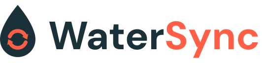

<h1>
  <picture>
    <source media="(prefers-color-scheme: dark)" srcset="docs/assets/watersync-logo-dark.svg">
    
  </picture>
</h1>

Python package and Databricks App for metadata-driven JDBC ingestion into Delta, with timestamp-watermark and EPIC Clarity CSA change tracking, SCD Type 2 history via Lakeflow Spark Declarative Pipelines, and Lakeflow Job provisioning.

Each row of a `jdbc_ingestion_config` Delta table describes one source table. WaterSync reads the changed rows over JDBC into Bronze staging tables, and a CDC pipeline turns them into Silver SCD Type 2 history. One Lakeflow Job per ingestion group runs it all, and the **Control Plane app** lets you configure, schedule and monitor it without writing SQL.

```
jdbc_ingestion_config ──► planner ──► one worker per table ──► Bronze staging ──► CDC SCD2 pipeline ──► Silver history
                                            │
                              jdbc_ingestion_watermark (state)
```

**Full documentation: [wiki/Home.md](wiki/Home.md)**

---

## Quick start

1. **Deploy the Control Plane app** with the bundle in the repo root:

   ```bash
   databricks bundle deploy -t dev
   ```

   The app uses the SQL warehouse named `Shared Unity Catalog Serverless`; pass `--var warehouse_id=<sql-warehouse-id>` to use another one.

2. **Open the app and pick a catalog and schema** for the metadata. The app creates the tables there.
3. **Add sources** on the **Configuration** page: discover tables over a UC connection or a JDBC URL, or add rows by hand.
4. **Create the job** on the **Jobs** page: Git source, job and SDP compute, schedule and run-as identity. Then run it.

Prefer code? Install the package (`%pip install -e /Workspace/Users/<user>/watersync`), run `watersync-setup-uc --catalog main --schema watersync`, and see [Installation and Setup](wiki/Installation-and-Setup.md).

## Promoting a configuration between environments

Export a location (source tables plus each group's job settings) to JSON, and import it elsewhere, from the app or from a deployment pipeline:

```bash
python scripts/watersync_config.py --profile dev export --catalog dev --schema watersync --output config/watersync.json
python scripts/watersync_config.py import --catalog prod --schema watersync --file config/watersync.json --replace-groups --deploy-jobs
```

See [Import and Export](wiki/Import-and-Export.md).

## Documentation

| Topic | Page |
| --- | --- |
| How it works | [Architecture](wiki/Architecture.md) |
| Install the package and create the metadata tables | [Installation and Setup](wiki/Installation-and-Setup.md) |
| Config columns, connecting to sources | [Configuration Table](wiki/Configuration-Table.md) |
| Notebook and CLI runs, worker types | [Running Ingestion](wiki/Running-Ingestion.md) |
| SCD Type 2 flows, full refresh | [CDC Pipeline and Full Refresh](wiki/CDC-Pipeline-and-Full-Refresh.md) |
| The app and the jobs it creates | [Control Plane App](wiki/Control-Plane-App.md) |
| Export, import, deployment pipelines | [Import and Export](wiki/Import-and-Export.md) |
| Jobs from Python or the CLI | [Job Provisioning](wiki/Job-Provisioning.md) |
| Test source database | [Lakebase Test Setup](wiki/Lakebase-Test-Setup.md) |
| Working on the app | [App Development](wiki/App-Development.md) |
| CI and repository layout | [Development and CI](wiki/Development-and-CI.md) |

## License

Released under the Databricks License. See [LICENSE.md](LICENSE.md) and [NOTICE.md](NOTICE.md). To report a vulnerability, see [SECURITY.md](SECURITY.md); to contribute, see [CONTRIBUTING.md](CONTRIBUTING.md).
